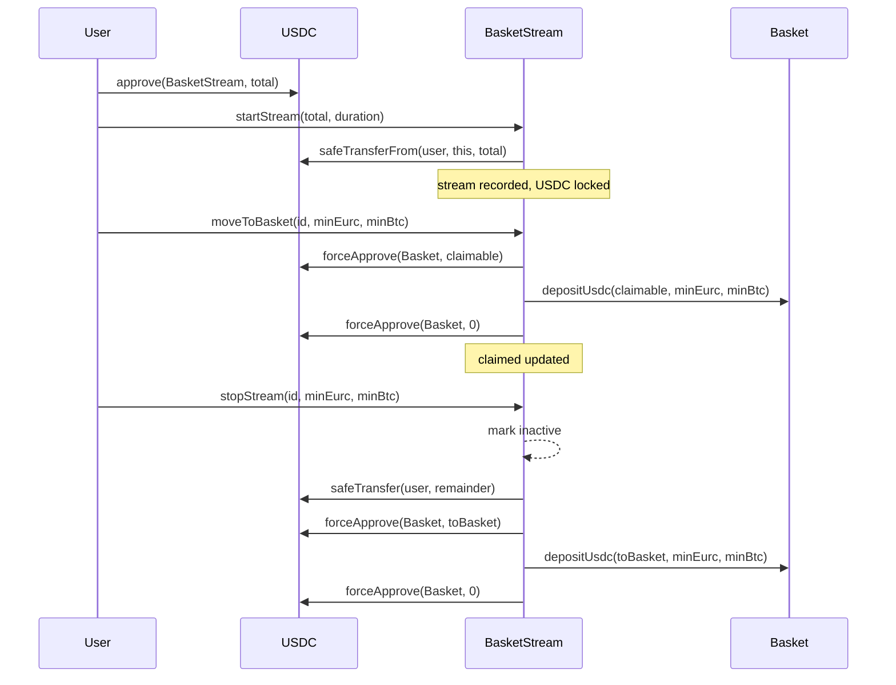

# BasketStream Contract — Design Document

**Status:** Draft  
**Target chain:** Arc Testnet (chain ID 5042002) / Arc Mainnet (chain ID 5042)  
**Language/toolchain:** Solidity ^0.8.24, Foundry, OpenZeppelin 5.1.0, Paris EVM  
**Milestone:** Phase 2 — Stream feature  
**Review tracker:**  
- [ ] Design review  
- [ ] Security review  
- [ ] Ops review  

---

## Action Items (living)
_(empty — first draft)_

---

## Goals / Non-Goals

**Goals:**
- Let users lock a total USDC amount over a chosen duration; USDC unlocks linearly second-by-second.
- Allow partial "move to basket": claim streamed-so-far, deposit it via the Basket contract into the user's allocation.
- Allow early stop: claim streamed amount to basket, return unstreamed remainder directly to user's wallet.
- Track all active streams per user; multiple concurrent streams allowed.
- No admin keys, no upgrades — immutable after deploy.

**Non-Goals:**
- No yield or interest on locked USDC.
- No stream-to-stream transfers or stream NFTs.
- No protocol fee.
- No cross-chain streaming (USDC must be on Arc).

---

## Requirements

**Functional:**
- `startStream(uint256 total, uint256 duration)` — user approves USDC first; contract pulls `total` USDC, records `startTime`, `endTime`, `total`, `claimed=0`.
- `moveToBasket(uint256 streamId, uint256 minEurc, uint256 minBtc)` — compute unlocked = `total * elapsed / duration` (capped at `total`), transfer `unlocked - claimed` to the Basket contract and call `basket.depositUsdc(amount, minEurc, minBtc)`, update `claimed`. Revert if nothing new to claim.
- `stopStream(uint256 streamId, uint256 minEurc, uint256 minBtc)` — compute remaining = `total - claimed`, split: `streamed - claimed` goes to basket, `total - streamed` returns to user as raw USDC. Mark stream complete.
- `getStream(uint256 streamId)` — view: returns full stream struct.
- `getStreams(address user)` — view: returns all stream IDs for user.
- `streamedSoFar(uint256 streamId)` — view: current unlocked amount (live, second-by-second).

**Security:**
- CEI (Checks-Effects-Interactions): state updated before external calls.
- `nonReentrant` on all state-changing functions.
- `SafeERC20` for all USDC transfers.
- `forceApprove` before calling `basket.depositUsdc` so Basket can pull USDC from this contract.
- Only the stream's owner can call `moveToBasket` / `stopStream`.
- `duration` must be > 0 and ≤ 365 days; `total` must be > 0.
- No dangling max-approvals: `forceApprove(0)` after each basket deposit.

---

## Terminology & Actors

| Actor | On/Off-chain | Trust level | What they can do |
|-------|-------------|-------------|-----------------|
| User (streamer) | On-chain EOA/wallet | Untrusted | Start, move, stop their own streams |
| BasketStream contract | On-chain | Trusted (self) | Hold USDC, call Basket.depositUsdc |
| Basket contract | On-chain | Semi-trusted (known address) | Receives USDC + depositUsdc call |
| USDC contract | On-chain | Trusted (Arc native) | ERC-20 token transferred by this contract |

---

## Language / Runtime

- Solidity ^0.8.24 (overflow checks built in; no `unchecked` needed).
- Paris EVM (no Cancun opcodes).
- OpenZeppelin 5.1.0: `ReentrancyGuard`, `SafeERC20`, `IERC20`.
- No proxy — immutable after deploy (constructor sets USDC + Basket addresses).

---

## Transaction & Execution Model

All functions are atomic. External calls only happen after state is written (CEI). The two external calls per `moveToBasket`/`stopStream` are: (1) `IERC20.safeTransfer` or `forceApprove` + basket call, (2) the basket's `depositUsdc`. Both are guarded by `nonReentrant`.

Re-entry surface: `stopStream` calls `usdc.safeTransfer` (to return remainder) and then (if streamed > 0) calls basket. Order: state cleared first (stream marked inactive, balances zeroed) before any transfer — so a re-entrant call from a malicious USDC hook would find the stream already inactive and revert.

---

## Architecture Overview



**Flow of funds:**

| Step | Who moves what | Invariant |
|------|---------------|-----------|
| startStream | User → contract: `total` USDC | contract USDC balance increases by `total` |
| moveToBasket | contract → Basket: `claimable` USDC | `sum(stream.claimed) ≤ sum(stream.total)` |
| stopStream (remainder) | contract → user: `total - streamed` USDC | no USDC stays locked after stop |
| stopStream (to basket) | contract → Basket: `streamed - claimed` USDC | full `total` accounted for |

Resting-state invariant: contract holds exactly `Σ(active stream totals - claimed)` USDC at all times.

---

## Contract Design

### Storage

```solidity
struct Stream {
    address owner;
    uint256 total;       // total USDC locked (6 decimals)
    uint256 claimed;     // already moved to basket
    uint64  startTime;
    uint64  endTime;
    bool    active;
}

mapping(uint256 => Stream) public streams;          // streamId => Stream
mapping(address => uint256[]) public userStreams;   // user => streamIds
uint256 public nextStreamId;                        // auto-increment
address public immutable usdc;
address public immutable basket;
```

### Functions (write)

| Function | Caller | State mutated | Events | Revert conditions |
|----------|--------|--------------|--------|------------------|
| `startStream(total, duration)` | any connected wallet | creates stream, increments nextStreamId | `StreamStarted(id, owner, total, endTime)` | total=0, duration=0 or >365 days, transfer fails |
| `moveToBasket(id, minEurc, minBtc)` | stream.owner | updates stream.claimed | `MovedToBasket(id, owner, amount)` | not owner, not active, nothing claimable, basket deposit reverts |
| `stopStream(id, minEurc, minBtc)` | stream.owner | marks inactive, zeroes balances | `StreamStopped(id, owner, toBasket, returned)` | not owner, not active |

### Functions (read)

| Function | Returns |
|----------|---------|
| `getStream(id)` | full Stream struct |
| `getStreams(user)` | uint256[] of stream IDs |
| `streamedSoFar(id)` | current unlocked amount (live) |

---

## Security Considerations

| Vulnerability | Applicable? | Mitigation |
|--------------|------------|------------|
| Reentrancy | Yes — external calls to USDC + Basket | CEI: state zeroed before transfers; `nonReentrant` on all write functions |
| Access control | Yes — owner-only on move/stop | `require(stream.owner == msg.sender)` |
| Integer overflow | No — Solidity 0.8 checked; `elapsed * total` handled with division ordering | — |
| Unchecked external call | `safeTransfer` + `forceApprove` via SafeERC20 | SafeERC20 wraps all calls |
| Timestamp dependence | Yes — linear unlock uses `block.timestamp` | Tolerable: per-second granularity; no incentive to manipulate for a private user's stream |
| Approval persistence | Yes — `forceApprove` before basket call | Zero out with `forceApprove(0)` after each basket deposit |
| DoS via large userStreams array | Low — user pays gas for their own streams; no admin loops | `getStreams` is view-only; no unbounded writes |
| Front-running | Low — `moveToBasket` uses caller-supplied `minEurc/minBtc` | Slippage guard forwarded to basket |

---

## Upgradeability

Not upgradeable — immutable after deploy. Migration path: deploy a new contract, users start new streams there.

---

## Deployment

Constructor: `constructor(address _usdc, address _basket)`. No init runbook beyond deploy. Both addresses are immutable. Deployer has no special rights post-deploy.
